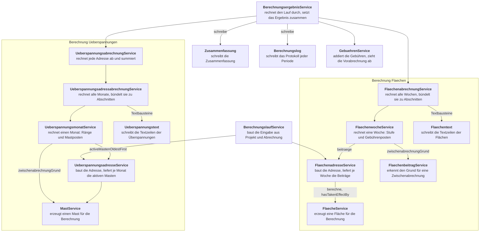

# Berechnung

Die Berechnung bildet aus einem `Projekt` und einer `Abrechnung` das `Berechnungsergebnis`: die Gebühren für Flächen, Überspannungen und Verwaltung, dazu die Texte, die Bescheid und Oberfläche anzeigen.

Der Code liegt unter `backend/src/main/java/de/muenchen/oss/sonar/backend/berechnung`.

